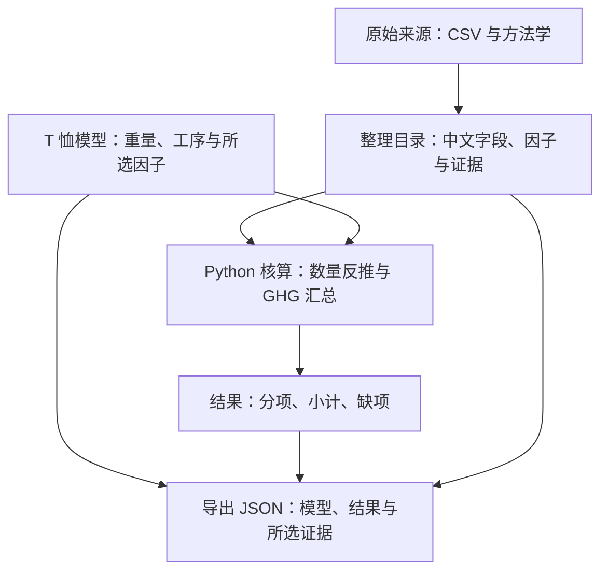

# Carbonfact 中文工作台学习路径：用一件 T 恤贯穿全程

日期：2026-10-04。适用版本：中文应用 v0.1.0（含迁移修订）。性质：学习与操作指南；不修改项目代码。

本地项目根目录：`C:\Tool\Code\Project\AI_code\lca-database-footwear-apparel-main`。本文中的项目路径均相对此根目录。

目标：能读懂一条工序因子，解释一件产品的活动量与小计，补充自己的数据，并把数据和核算能力接到自己的项目。

## 贯穿案例与学习边界

始终使用现有 `examples/tshirt.json`：一件 140 g 棉 T 恤，60% 有机棉、40% 再生棉；纺纱 → 圆机针织 → 棉前处理/漂白 → 活性染色 → 柔软整理 → T 恤装配。声明范围为原料至成衣出厂。

重量、配比和流程是结构模板的教学设定，不是实际工厂资料。前处理投入比 1 也只是示范假设。模板选项仍需核实工艺适用性，例如再生棉是否适用所选精梳环锭纺条件。

默认模型有合法输入与可计算工序，但原料、前处理等尚未覆盖，所以状态为 `partial`。我在交付代码中重新计算，默认已覆盖小计为：

`1.7587612014455535026925731984 kg CO₂e/件`

页面显示约 `1.75876`。这不是完整产品碳足迹。下文练习的数值由当前代码计算，用户本机应按步骤对照。

## 第一轮：认识项目中的五个对象

| 对象 | T 恤案例里的实例 | 你用它做什么 |
|---|---|---|
| 原始来源 | 染色 CSV、染色方法学 PDF | 知道数值从哪里来、代表什么工艺 |
| 整理后的因子目录 | 中文名、单位、GHG、投入比、证据路径 | 搜索与筛选候选因子 |
| 产品模型 | 140 g、60/40 配比、六个工序、所选因子 | 记录这件产品怎样被核算 |
| 核算程序 | `carbonfact_app/engine.py` | 反推数量、确定性计算、发现缺项 |
| 核算结果与导出 | 分项、小计、缺项、模型与所选公开记录 | 解释、重算、比较和交接 |

工序结果的使用逻辑如下：



现有项目无需先部署数据库服务器。原始文件库提供结果和部分建模说明；中文应用增加组织、解释与计算。原始记录保存 16 项影响值，目前产品引擎汇总 GHG，其余指标供浏览。

阅读：`PROJECT.md` → `docs/中文入门.md`。

本轮达标：能分别指出“因子”“产品模型”“结果”的位置，知道修改产品重量不会修改原始因子。

## 第二轮：启动并保存一份默认基线

在项目根目录运行：

```powershell
python app.py
```

浏览器访问 `http://127.0.0.1:8768`。终端需保持运行；结束时按 Ctrl+C。

1. 打开“产品与工序链”。
2. 结构模板选“一件 T 恤”，点“载入模板”。
3. 确认每件成品质量为 140 g、结果口径为每件，原料生产纳入边界。
4. 查看六个主布工序，以及有机棉/再生棉 60/40 配比。
5. 查看右侧“已覆盖部分排放”、贡献、尚未覆盖/待确认。
6. 点“保存模型与证据”，把下载的 `carbonfact-model.json` 重命名为 `tshirt_140g_baseline.json`。
7. 在项目根新建 `local-data/`，把保存文件放进去。页面下载本身不会自动写入此目录。

默认有 12 条缺项/待确认提示。这不是 12 道缺工序：例如同一项包装可能分别缺因子与活动量，还有边界及装配重叠复核。

此时先保留未确认状态。边界复核勾选表示你已实际核对；它不是消除提示的开关。

本轮达标：能保存默认模型，并用“加载 JSON”重新载入，看到同一小计。页面会用后台重算，保存文件中的旧结果不会直接成为新结果。

## 第三轮：只深读一条活性染色因子

先在 T 恤的“活性染色”环节点“数值与来源”。也可以切换“浏览因子”，筛选染色，搜索“柔流喷射”或“活性”。

模板实际选择：

| 字段 | 值 | 怎样理解 |
|---|---|---|
| 中文名 | 织物染色 · 浸染 · 柔流喷射 · 活性染料 · 纤维素纤维 · 中等色深 | 技术、对象与代表条件共同限定适用性 |
| 应用标识 | `cf-951c0b29eb12a7d1` | 产品模型用它选择记录 |
| 功能单位 | 每 kg 染色对象产出 | 分母不是 kg 染料，也不是一件衣服 |
| GHG 原值 | `4.001597083425285 kg CO₂e/kg` | 该代表工艺已经计算出的气候影响 |
| 投入产出比 | `1.092` | 在主布质量链中，每 1 kg 产出对应 1.092 kg 投入 |
| 地域标签 | `WORLD` | 不自动变成你工厂所在地的专属结果 |

原始描述符：

```text
MATERIAL_PROCESS_STEP:COLORATION/DYEING/FABRIC/REACTIVE/BATCH/SOFTFLOW_JET#NATURAL_FIBERS@WORLD
```

按这个顺序看来源：

1. `docs/processes/dyeing.md`：先读中文工序卡，知道投入、产出与范围。
2. `upstream/carbonfact/datasets/dyeing/README.md`：核对功能单位和类别说明。
3. `upstream/carbonfact/datasets/dyeing/impact-scores.csv`：核对所选英文活动、描述符、GHG 与投入字段。应用标注逻辑记录 24；复杂 CSV 的逻辑记录不必等于编辑器物理行号。
4. `.../methodology/Dyeing_DB_Methodology.pdf`：研究工艺范围、假设及建模逻辑。
5. `.../methodology/Dyeing_Chemicals_Methodology.pdf`：研究染料/助剂换算及背景代理。

阅读时写下四句话：处理什么对象？每多少产出？包括什么？排除什么？

这类染色范围包括核心染色、后洗/漂洗、相关干燥与轧液；排除前处理、防缩与紧缩。因此前处理仍需要独立核查；另加后洗、烘干或同范围电热时要避免重复。

GHG 总值不能唯一反推出全部电、蒸汽、水、染料与助剂用量。公开资料能支持研究部分公式与背景映射，不能保证完整复现底层模型。数据年未知保留未知；DQR 不等于数值误差范围。`IOR` 是电离辐射指标，不是投入产出比。

本轮达标：能向别人解释这条记录为什么可作为这件 T 恤的候选，以及还需要核实哪些工艺条件。

## 第四轮：手算一段，再看整条质量链

页面顺序是生产顺序，程序从成衣向上游反推。

对每个工序：

`加工排放 = 工序产出量 × 该工序 GHG 因子`

`工序投入量 = 工序产出量 × 投入产出比`

`前一道工序所需产出量 = 后一道工序投入量`

从 T 恤装配开始：

```text
成衣产出 = 140 g = 0.14 kg
装配投入比 = 1.1494
所需装配前面料 = 0.14 × 1.1494 = 0.160916 kg
装配加工排放 = 0.14 × 0.14694206254984066
             = 0.0205718887569776924 kg CO₂e
```

柔软整理投入比为 1，因此它的产出、投入均为 0.160916 kg。染色需要提供 0.160916 kg 给整理：

```text
染色投入 = 0.160916 × 1.092 = 0.175720272 kg
染色加工排放 = 0.160916 × 4.001597083425285
             = 0.643920996276463161060 kg CO₂e
```

展开页面结果中的“各工序数量与损耗”，对照下表。显示数值做了舍入：

| 工序 | 产出 kg | 投入 kg | GHG 因子，kg CO₂e/kg 产出 | 本件加工贡献，kg CO₂e |
|---|---:|---:|---:|---:|
| 纺纱 | 0.181168 | 0.218832 | 2.450725 | 0.443992 |
| 圆机针织 | 0.175720 | 0.181168 | 3.240313 | 0.569389 |
| 棉前处理/漂白 | 0.175720 | 0.175720 | 缺因子 | 未计入 |
| 活性染色 | 0.160916 | 0.175720 | 4.001597 | 0.643921 |
| 柔软整理 | 0.160916 | 0.160916 | 0.502670 | 0.080888 |
| T 恤装配 | 0.140000 | 0.160916 | 0.146942 | 0.020572 |

表中舍入分项相加可能与后台完整精度小计相差末位。后台小计约 1.7587612；起始纤维投入约 0.218832 kg，总质量损失约 0.078832 kg。

按当前统一主布链、配比保持不变的假设，起始材料量是：有机棉约 0.131299 kg，再生棉约 0.087533 kg。它们的原料生产因子尚未填写，所以没有原料生产贡献。这里原料量按起始投入分配，不能只按最终 0.14 kg 分配。

投入比 1.1494 表示每 1 kg 产出需 1.1494 kg 投入；按投入定义的损耗率为 `(1.1494−1)/1.1494`，约 13%，不是 14.94%。前处理表中零质量损失来自模板假设，不表示已掌握真实前处理质量或零排放。

阅读：`docs/核算规则.md`；纺纱只优先读 ring-spun 专属方法学，圆机针织优先读 circular-knitting，不需要立刻读所有设备路线。

本轮达标：能解释为什么不能把五个加工因子简单相加，再统一乘 0.14 kg。

## 第五轮：做三个单变量练习

每个练习前重新载入“一件 T 恤”，必要时重新“设为比较基线”。载入模板会替换当前输入，基线仍保留；刷新页面会丢失内存中的基线。

| 练习 | 操作 | 当前代码的预期结果 | 学到什么 |
|---|---|---|---|
| 重量 | 140 g 基线改为 280 g，其他不变 | 小计约 3.51752，增加约 1.75876；仍 partial | 当前模板已覆盖质量项随重量同比变化 |
| 材料配比 | 140 g，60/40 改为 80/20，配比合计 100% | 小计仍约 1.75876 | 原料因子缺失；当前加工链也没有分别为两类棉改变参数，不能据此判断实际配比无影响 |
| 装配损耗 | 140 g，在装配将“数量传递依据”改为“按投入定义的损耗率”，填 20%，填写教学假设依据 | 投入比 1.25；装配投入 0.175 kg；起始投入约 0.237985 kg；小计约 1.91089 | 损耗改变上游所需量 |

损耗练习填写：`纯教学假设：按投入质量定义损耗20%，不代表原模型或工厂实测`。本练习沿用公开整项加工因子，展示数量传播；没有重新建立原工序模型，也不表示该因子已适配新损耗条件。

20% 按投入损耗的换算为 `投入比=1/(1−0.20)=1.25`。不能直接写成 1.20。

基线差值只比较当前同边界、同口径、同缺项集合的已覆盖小计。它不代表完整产品差异，也不自动证明现实减排。选低 GHG 因子前仍需确认真实工艺匹配。

本轮达标：先预测结果，再修改输入，解释程序变化或不变化的原因。

## 第六轮：把缺项转成你的采数清单

保持这件 T 恤的边界，准备如下资料；先取得事实，再填界面：

| 缺口 | 需要取得什么 | 填在哪里 |
|---|---|---|
| 有机棉/再生棉生产 | 适用的原料生产因子，单位、来源、范围与分配依据 | “补充外部因子”中选原料生产，再在材料行选择 |
| 前处理/漂白 | 匹配工艺的加工因子，或完整企业投入清单；真实投入比 | 对应工序的因子/清单与数量依据 |
| 其他配件 | 本件实际活动量，以及装配范围外的因子 | “原料、损失材料与独立项目” |
| 补充包装 | 当前装配因子已含哪些包装、实际额外包装量及因子 | 独立项目，只补范围外部分 |
| 边界内运输 | 对应运输活动量、方式、范围及因子 | 独立项目，单位例如 tkm |
| 损失材料处理 | 废料去向、活动量与对应处理因子；是否已内含 | 损失材料处理，或有依据的独立项目拆分 |
| 边界及装配重叠 | 包含/排除项、裁剪损失、内含缝线/包装与外置项目的核对证据 | 边界复核、装配“重复与边界复核依据” |

外部因子的 GHG 是“kg CO₂e/所选活动量单位”。例如原料因子通常按 kg 材料，电力按 kWh，不能把整批碳排放总值填成单位因子。

状态“待审阅”或“假设演示”可以用于学习计算，结果仍保留待确认；只有真正核对来源后才改为“已自行审阅”。本指南没有提供虚构的棉生产或前处理因子。

纺纱因子代表加工，不能选它去补棉花原料生产。装配专属说明已列缝线、包装与裁剪损失，需要核查重复，不能因为界面有空位就再加一次。已确认不属于目标范围或已被覆盖的独立项目可以写明确排除理由；未知不能填 0 来消除缺项。

真实产品若有多个明显不同的部件、不同材料处理路线或回收回流，不能直接套当前单一主布链完成严格核算。先把主布与独立项整理清楚，复杂质量网络需要后续扩展。

本轮达标：每条缺项都有“资料需求、来源、负责人或待取得状态”，能解释为什么目前仍是 partial。

## 第七轮：仍用这件 T 恤，学习企业染色投入路径

先保存当前模型，然后只改变“活性染色”这个工序的核算路径：从“已发布整项工序因子”切换为“企业投入清单”。

切换会清空原整项因子，并将数量依据改为手动。用于学习对照时，把染色投入比填回 1.092，注明沿用公开代表工艺；企业核算应改用实测依据。保持其他 T 恤环节不变。

在该工序点击“＋ 投入项”，按你有的资料建立电、热、水、染料/助剂、废水等条目。每项 quantity 都是**每 1 kg 本工序产出**的耗用，后台再乘本工序产出量。

以当前染色产出 0.160916 kg 为例：

`本件用电 = 每 kg 染色产出耗电 × 0.160916 kg`

`本件用电排放 = 本件用电 × 适用电力因子`

若资料是整批总耗用，先除以对应批次本工序产出量，取得每 kg 系数，再填清单。不要把整批总量直接填成每 kg 耗用。

助剂剂量的纯教学示例：一份浴液浓度 2 g/L、浴液量 10 L/kg，则助剂为 `2×10/1000=0.02 kg/kg`；本件对应 `0.02×0.160916=0.00321832 kg`。这些是假设参数，不是 Carbonfact 默认配方，也不代表全部洗涤用水或多浴总耗用。

同一染色范围使用整项因子和企业清单两条路径中的一条。缺项、未核对清单完整性或待审阅因子仍会保留 partial。只有确认清单涵盖所声明范围后，才勾选清单覆盖完整性。

想看现成投入结构，可另开查看 `examples/inventory.json` 或载入“企业投入清单”模板；载入会替换整份当前模型，先保存 T 恤。另一个工厂模板是批次口径，本案例继续用每件口径。

本轮达标：能说明“使用已计算工序因子”与“自己建立工序投入清单”分别需要哪些数据，以及怎样避免叠加。

## 第八轮：保存、命令行重算与比较

建议你的学习文件放在 `local-data/`：

| 文件 | 内容 |
|---|---|
| `tshirt_140g_baseline.json` | 默认基线的模型、结果与证据 |
| `tshirt_280g.json` | 重量练习的导出 |
| `tshirt_loss20_teaching.json` | 明确标记教学假设的损耗练习 |
| `tshirt_my_product.json` | 用实际资料逐步替换后的产品模型 |

网页“保存模型与证据”导出包含 `model`、`result`、`selected_source_records` 和 `attribution`；其余结构字段包括 format、schema_version。它保存所选公开记录与来源路径，不把全部方法学 PDF 打包进 JSON。

用默认案例直接命令行核算：

```powershell
python tools/calculate.py examples/tshirt.json --output local-data/tshirt-result.json
```

生成和网页保存相同类型的模型与证据包：

```powershell
python tools/calculate.py examples/tshirt.json --export --output local-data/tshirt-model.json
```

重算你在网页保存并移入 local-data 的文件：

```powershell
python tools/calculate.py local-data/tshirt_140g_baseline.json --output local-data/tshirt-recalculated.json
```

比较网页导出的 280 g 版本和 140 g 基线：

```powershell
python tools/calculate.py local-data/tshirt_280g.json --baseline local-data/tshirt_140g_baseline.json --output local-data/tshirt-comparison.json
```

查看 `status`、`valid`、`complete`、`subtotal_ghg`、`missing`，不要只取一个碳值；比较结果还应检查 `comparable`。输入正确但缺项时 valid 可以为 true、complete 为 false。数值在 JSON 中常用字符串，保持十进制精度。

工具的职责：

| 命令 | 什么时候使用 |
|---|---|
| `python tools/data_workbench.py audit` | 了解来源记录、空行和缺失字段盘点 |
| `python tools/data_workbench.py validate` | 检查来源与整理数据是否一致 |
| `python tools/data_workbench.py build` | 修改中文映射/类别元数据后重新构建；日常产品使用通常不需要 |
| `python tools/calculate.py ...` | 重算、比较、导出产品模型 |
| `python -m unittest discover -s tests -v` | 修改代码规则后验证受影响行为 |

更改中文映射或类别数据可能改变 catalog_digest，旧模型需要重新核对选择。不要直接修改 `data/processed/` 的因子数值；构建输入是 `data/activity_names_zh.csv` 与 `data/categories.json`，原始值来自来源层。

本轮达标：同一模型在网页与命令行得到同一后台小计，知道普通结果文件与模型证据包的区别。

## 第九轮：接到自己的项目，形成一个标准工序模块

先在人工流程中把这件 T 恤说明清楚，再接自动化。当前程序没有自动审批因子或自动生成标准工序模块的 LLM 功能。

从项目根执行的 Python 调用示例：

```python
import json
from pathlib import Path
from carbonfact_app.catalog import load_catalog
from carbonfact_app.engine import calculate

model = json.loads(Path("examples/tshirt.json").read_text(encoding="utf-8"))
result = calculate(model, load_catalog())
print(result["status"], result["subtotal_ghg"])
for gap in result["missing"]:
    print(gap["message"])
```

其他本地工程调用时，可以先把本项目根目录加入该调用脚本的 sys.path，再导入相同模块；避免复制成另一套计算规则。

也可以保持本地服务运行，通过 HTTP 接入：

| 接口 | 用途 |
|---|---|
| GET `http://127.0.0.1:8768/api/catalog` | 获得整理目录，作为候选因子与来源数据 |
| GET `/api/templates` | 获得三个结构模板 |
| POST `/api/calculate`，请求 `{"model": ...}` | 得到确定性计算结果 |
| POST `/api/export` | 导出模型、结果、所选记录与署名 |

这些接口仅监听本机。业务校验失败可能仍返回 HTTP 200，必须检查响应的 valid、complete 和 missing。

在你的标准工序研究中，可把这条染色记录整理成如下模块草案；当前应用没有持久化这一通用模块，它是你后续知识建模的起点：

| 模块信息 | 本案例草案 |
|---|---|
| 你的标准工序标识 | 例如 `sp-cotton-reactive-softflow`，与你的工序体系独立维护 |
| 工序名称 | 棉织物活性染色：柔流喷射浸染 |
| 适用条件 | 纤维素织物、活性染料、柔流喷射、中等色深；实际配方/设备需核对 |
| 输入/输出 | 待染织物 → 染色织物；能源、物料与废水按路径登记 |
| 功能单位 | 1 kg 工序产出 |
| 数量传递 | 公开代表记录投入比 1.092；企业使用改为有依据参数 |
| 因子映射 | `cf-951c0b29eb12a7d1` + 原始 descriptor + catalog_digest |
| 包含/排除 | 核心染色、后洗/相关干燥等；前处理等另核查 |
| 证据与选择理由 | 染色 CSV、方法学与材料/工艺匹配理由 |
| 核算规则 | 产出量乘 GHG；整项因子和企业投入清单互斥 |
| 未知与审阅 | 企业参数、背景适用性、完整性；保留待确认 |

Carbonfact 能提供候选因子和部分方法学依据；标准工序的定义、顺序规则、业务适用性与审批依据需要你另外整理。中文名只是阅读入口，原始标识、单位、边界与版本也必须保留。

后续接入智能体时：LLM 负责从企业表达识别工序、提出候选与解释；人负责数据和因子适用性审阅；程序负责单位、规则、数量传播与确定性计算。已有项目的企业规则或因子不能未经核对直接套入本案例。

本轮达标：把一个染色模块的定义、证据、候选映射和执行规则讲清楚，再扩到整条链。

## 项目各部分的使用索引

| 路径 | 什么时候看/用 | 用 T 恤贯穿时关注什么 |
|---|---|---|
| `README.md`、`PROJECT.md` | 初次了解项目 | 范围、入口与当前能力 |
| `docs/中文入门.md` | 建立业务理解 | 因子、功能单位、活动量与公开深度 |
| `docs/processes/` | 按工序学习 | spinning、knitting、dyeing、finishing、textile-assembly |
| `docs/字段字典.md` | 阅读原始/整理记录 | GHG、投入比、单位、DQR、来源 |
| `docs/核算规则.md` | 解释计算与缺项 | 单主布链、损耗、互斥与比较 |
| `docs/已知差异.md` | 发现来源不一致时 | 单位、数值、损失与装配包含项 |
| `upstream/carbonfact/` | 回查原文或研究建模 | 对应 CSV、README、专属方法学 |
| `data/processed/factors.json` / `.csv` | 导入你的项目或筛选候选 | 保留标识、单位、来源、边界与版本 |
| `data/activity_names_zh.csv`、`data/categories.json` | 维护中文解释时 | 修改展示/说明，不改上游影响值 |
| `examples/tshirt.json` | 学习模型合同 | 六工序、缺项、原料与独立项目 |
| `local-data/` | 存个人模型与结果 | 每次学习、修改与企业模型 |
| `carbonfact_app/catalog.py` | 开发数据适配时 | 加载、构建与来源验证 |
| `carbonfact_app/engine.py` | 开发核算规则时 | 数量、贡献、缺项与比较 |
| `carbonfact_app/templates.py` | 开发新模板时 | 结构模板与显式未知 |
| `app.py`、`web/` | 接口/界面开发时 | 页面输入传给同一个 Python 引擎 |
| `tools/`、`tests/` | 批处理、维护、代码修改后验证 | 命令行与已验证规则 |
| `WORKLOG.md`、`MEMORY.md`、`docs/adr/`、`topics/` | 接续开发或确认后续范围时 | 当前状态、稳定规则、采用的选择和候选议题 |

迁移已经由你报告完成；正常学习与日常核算不需要再运行 prepare_upgrade。

## 推荐推进顺序与完成标准

第一次：第 1–3 轮，保存默认 T 恤，能解释一条染色因子。

第二次：第 4–5 轮，能手算装配和染色，完成重量、配比、损耗三个练习。

第三次：第 6–8 轮，形成采数清单，理解企业投入路径，保存并用命令行重算。

第四次：第 9 轮，把一个工序变成有证据与规则的模块，接入自己的工程。学习时长自行安排，以可检查的成果为结束点。

最后你应能回答：1. 为什么这条因子适用或不适用？2. 0.160916 kg 怎么得到？3. 1.75876 覆盖什么、缺什么？4. 换工艺或配比会改变哪些项？5. 别人能否用同一输入与版本复算？

数值证据来自现有 `examples/tshirt.json`、对应 CSV 与 `carbonfact_app/engine.py`；本指南重新核算默认值与三个练习。它不证明上游科学模型已完整复现，也不证明实际企业工艺或完整标准符合性。
